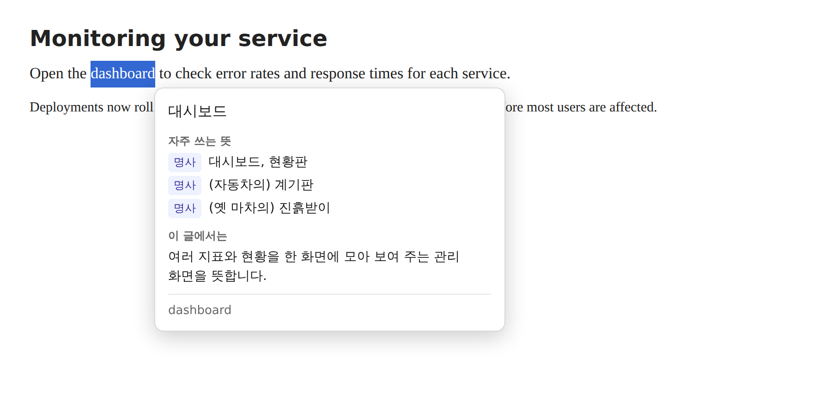
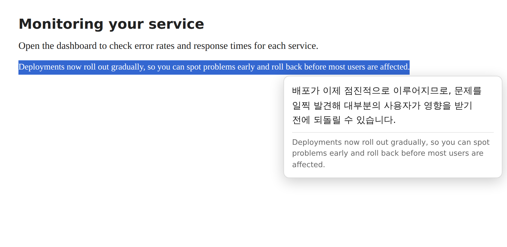
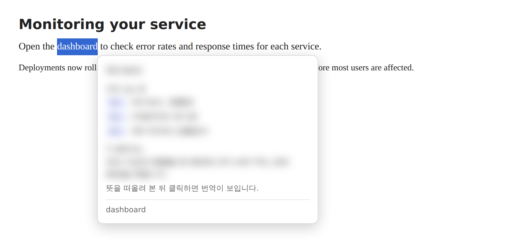
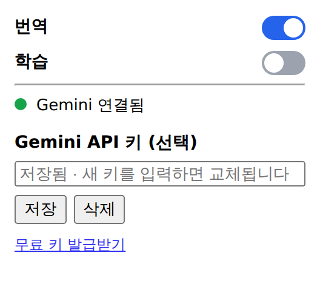

# 드래그 영어 번역

웹페이지의 영어를 드래그하면 마우스 아래에 한국어 번역을 보여 주는 영어 공부용 Chrome 익스텐션입니다. 단어를 드래그하면 품사별 뜻과 그 글에서의 의미까지 함께 볼 수 있어, 페이지를 벗어나지 않고 읽으면서 공부할 수 있습니다.

> 이 문서의 스크린샷은 실제 익스텐션 화면이지만, 번역과 설명은 예시 데이터입니다. 실제 내용은 Gemini 응답에 따라 달라집니다.

## 주요 기능

### 단어와 짧은 표현: 뜻과 맥락

단어나 네 단어 이하의 표현을 드래그하면 항상 같은 순서로 보여 줍니다.

1. 문맥에 맞는 번역
2. 품사와 함께 자주 쓰는 뜻 (최대 3개)
3. 이 글에서의 의미 (한 문장)
4. 원문

같은 `dashboard`라도 IT 글에서는 대시보드, 자동차 기사에서는 계기판처럼 앞뒤 글을 참고해 뜻을 고릅니다. 이 기능은 Gemini API 키를 등록했을 때만 쓸 수 있습니다.

### 긴 문장: 번역

문장을 드래그하면 번역과 원문을 보여 줍니다.

### 학습 모드: 먼저 떠올리고 확인하기

학습 모드를 켜면 번역과 뜻, 설명이 가려진 채로 나타납니다. 뜻을 먼저 떠올려 본 뒤 툴팁을 클릭하면 내용이 보입니다.

### 설정 팝업

툴바 아이콘을 누르면 팝업에서 다음을 설정할 수 있습니다.

- **번역, 학습 토글:** 기능을 켜고 끕니다. 기본값은 모두 꺼짐입니다.
- **연결 상태 점:** 녹색은 Gemini 연결됨, 빨간색은 연결 안 됨이며 옆에 이유를 표시합니다. 팝업이 열려 있는 동안 갱신됩니다.
- **API 키:** 저장, 교체, 삭제할 수 있습니다. 저장한 키는 다시 볼 수 없습니다.

## 설치

Chrome 웹 스토어에는 등록되어 있지 않으므로 직접 설치합니다.

1. [Build extension](https://github.com/ksthink/google_ext/actions/workflows/build.yml)에서 최신 실행을 엽니다. 내려받으려면 GitHub 로그인이 필요합니다.
2. 페이지 아래 **Artifacts**에서 `extension-<커밋 해시>`를 내려받아 압축을 풉니다. 아티팩트는 기본 90일 동안 보관됩니다.
3. Chrome에서 `chrome://extensions`를 열고 오른쪽 위 **개발자 모드**를 켭니다.
4. **압축해제된 확장 프로그램을 로드합니다**를 누르고 압축을 푼 폴더를 선택합니다.
5. 이미 열려 있던 탭은 새로고침합니다.

새 버전으로 바꿀 때는 기존 익스텐션을 삭제하고 같은 방법으로 다시 설치합니다. 삭제하면 설정과 API 키가 지워지므로 다시 입력해야 합니다.

## 사용법

1. 팝업에서 **번역**을 켭니다.
2. Gemini를 쓰려면 [Google AI Studio](https://aistudio.google.com/apikey)에서 키를 발급받아 팝업에 저장합니다. 이 익스텐션 전용 키를 만드는 것을 권장합니다.
3. 웹페이지에서 영어를 드래그합니다.
4. Esc를 누르거나, 바깥을 클릭하거나, 페이지를 스크롤하면 툴팁이 닫힙니다.

이미 선택된 글을 다시 드래그하면 브라우저가 글자 끌어 옮기기로 처리해 번역이 뜨지 않습니다. 빈 곳을 한 번 클릭한 뒤 드래그해 주세요.

## 이용 범위

### 지원 환경

- 데스크톱 Chrome 138 이상에서 사용할 수 있습니다. 모바일은 지원하지 않습니다.
- 영어를 한국어로 번역합니다. 한글이 더 많은 글을 드래그하면 툴팁이 뜨지 않습니다.
- 한 번에 3,000자까지 번역합니다.

### 번역 엔진

| | Gemini | Chrome 내장 번역 |
|---|---|---|
| **사용 조건** | API 키 등록 | 키가 없을 때 자동 사용 |
| **번역 품질** | 문맥을 반영해 더 자연스러움 | 기본 수준 |
| **뜻과 맥락 설명** | 단어와 짧은 표현에 제공 | 제공 안 함 |
| **처리 위치** | Google 서버 | 내 기기 |
| **HTTP 페이지** | 가능 | 불가 (HTTPS만 가능) |
| **처음 사용할 때** | 키 입력 | 번역 모델 내려받기 |

Gemini 모델은 `gemini-3.5-flash-lite`를 사용합니다.

### 번역되지 않는 곳

- 페이지 안에 삽입된 iframe 속 글
- PDF 뷰어, `chrome://` 페이지, Chrome 웹 스토어
- Google Docs처럼 글자를 일반 텍스트로 표시하지 않는 사이트

### Gemini 사용량

- 무료 등급 안에서는 요금이 발생하지 않지만 사용량 한도가 있습니다. 한 계정의 AI Studio 화면 기준으로 분당 15회, 하루 500회였으며(2026년 11월), 계정과 시기에 따라 달라질 수 있습니다. 내 한도는 [AI Studio](https://aistudio.google.com/rate-limit)에서 확인하세요.
- 영어를 드래그하거나 더블클릭해 선택할 때마다 1회로 계산됩니다.
- 한도는 API 키가 아니라 프로젝트 단위로 적용됩니다. 일일 한도는 태평양 시간 자정에 초기화됩니다.

### 전송되는 데이터

Gemini를 쓰면 다음 내용이 Google로 전송됩니다. 개인정보나 민감한 글은 드래그하지 않는 것이 좋습니다.

- 드래그한 글
- 단어나 짧은 표현일 때는 같은 문단의 앞뒤 글(각 300자 이내)과 페이지 제목

**무료 등급에서는 전송한 내용이 Google 제품 개선에 쓰일 수 있습니다.** 자세한 내용은 [Gemini API 요금 안내](https://aistudio.google.com/docs/pricing)를 확인하세요. 입력칸에 적은 값은 전송하지 않습니다. 키를 등록하지 않으면 번역은 기기 안에서 처리되고 Google로 글을 보내지 않습니다. 이 익스텐션에는 별도의 서버가 없습니다.

### API 키 보안

- 키는 내보낼 수 없는 AES-GCM 256비트 키로 암호화해 이 브라우저에만 저장합니다. 저장소에는 올라가지 않습니다.
- 웹페이지는 저장된 키에 접근할 수 없습니다.
- 다만 번역하려면 익스텐션이 키를 복호화해야 하므로 노출 위험이 완전히 없어지지는 않습니다. PC에 악성 프로그램이 있거나, 잠금 해제된 PC를 다른 사람이 만지거나, Chrome 프로필이 통째로 복사되면 키가 유출될 수 있습니다. 유출이 의심되면 [AI Studio](https://aistudio.google.com/api-keys)에서 키를 바로 폐기하세요.

### 번역 결과

AI가 만든 번역과 설명, 뜻의 순서는 틀릴 수 있습니다. 공부에 참고하는 용도로 쓰고, 중요한 내용은 사전이나 원문으로 확인하세요.

### 라이선스

아직 오픈소스 라이선스를 지정하지 않았습니다. 코드를 재사용하거나 배포하려면 저장소 소유자에게 문의해 주세요.

## 개발

익스텐션 소스는 `extension/` 폴더에 있으며 빌드 단계나 외부 의존성이 없습니다. 브랜치에 푸시하면 GitHub Actions가 `manifest.json`을 검사한 뒤 이 폴더를 아티팩트로 올립니다.
